# Update Workbench

Update Workbench is a native macOS app that finds and installs updates for your apps and command-line tools. It covers Homebrew, the Mac App Store (through `mas`), Sparkle feeds, Electron apps and GitHub releases, and runs safety checks before every install. Nothing installs until you choose Update.

## Install

1. Download the latest `UpdateWorkbench-<version>.dmg` (or the `.zip`) from the [Releases page](https://github.com/Kasakir-AI/UpdateWorkbench/releases).
2. Open the DMG and drag **Update Workbench** into **Applications**.
3. **First launch:** the app is ad-hoc signed and not notarized by Apple, so macOS blocks a normal double-click the first time. Right-click (or Control-click) the app in Applications and choose **Open**, then **Open** again. Or try to open it once, then go to **System Settings → Privacy & Security** and click **Open Anyway**. After that it opens normally.

Requires macOS 14 or newer on Apple silicon. Check the download against `SHA256SUMS` with `shasum -a 256 -c SHA256SUMS`.

**Upgrading from 0.3.x:** quit Update Workbench, drag the new version into Applications and choose **Replace**. Settings, rules and approvals are kept. You may need the right-click **Open** step once more.

**App Store updates (optional):** install the free `mas` tool with **Homebrew → Install mas…** (or `brew install mas` in Terminal) and stay signed in to the App Store app. When mas needs your Mac password to install an App Store update, click **Finish in Terminal** and type the password there. Update Workbench never sees it. You can also click **Open App Store Updates** and update in the App Store app.

## Build from source

Requires Xcode command-line tools.

```sh
./build.sh   # builds dist.noindex/UpdateWorkbench.app (ad-hoc signed)
./test.sh    # offline test suite
./make-release.sh   # DMG, ZIP and SHA256SUMS in release/
```

Builds go to `dist.noindex/`. Spotlight skips folders whose names end in `.noindex`, so development builds, test fixtures and release staging never appear in Spotlight or Launchpad next to the copy in Applications.

## New in 0.4.0

- **Signer changes you can review.** If an update is signed by a different developer team, Update Workbench stops and shows both teams with their certificate details. You can approve the new team for that one app after confirming; approvals are listed with dates in Settings → Trust and can be revoked. Code signing and Gatekeeper still have to pass.
- **DMG installs.** Disk images are attached read-only and hidden from Finder, license agreements are shown before mounting, exactly one matching app is copied out with the full set of checks, and the image is always detached.
- **History.** Every update attempt is logged in the History section with its result.
- **No leftover copies.** Installs swap the new version in, verify it, then delete the old one (or put it back if anything fails). Nothing is left in `/Applications`.
- **App Store with mas.** Install mas from the Homebrew menu, see App Store updates with the rest, and update them (with a Terminal hand-off when mas needs your password).
- **Menu bar and scheduled checks.** Check daily or weekly in the background, with optional notifications. The menu bar icon shows the update count and a quick list. Nothing installs automatically.
- **Release notes.** "What's new" is shown in the detail pane and before each update, sanitized and rendered as plain native text.
- **Rules.** Skip a version, ignore an app, or hold back betas globally or per app, all managed in Settings → Rules.
- **Fixes.** An app updated while Update Workbench was open no longer stays in the update list (versions are read fresh from disk), and a launch hang in an early 0.4.0 build is fixed.

## Interface (0.3.0)

- **Dark by default** with color accents. Settings → Appearance offers Dark (default), Light or System.
- **Simple main flow:** the Updates hero card says how many updates are waiting, with **Check for Updates** / **Update All** buttons. Each row that can be installed here has its own **Update** button. Every install still asks first.
- **Color-coded badges** for each source (Homebrew, Formula, App Store, Sparkle, GitHub, Electron, Vendor, Manual) and status (Update ready, Manual update, Updates itself, Snoozed, Version skipped, Ignored, Update failed, Up to date). Badges always include an icon and text, so color is never the only signal.
- **Detail pane in cards:** versions with the main action first, then update source, suggestions, details, app security, a collapsed *Custom update source* section, and a **Manage** card with red destructive actions behind confirmations. A **Later** menu groups skip, snooze and ignore.
- **Guided empty, loading and error states**, a status footer in the sidebar, sidebar count badges, tooltips, VoiceOver labels and a collapsible activity console.
- **Keyboard shortcuts:** ⌘R check, ⇧⌘U update all, ⇧⌘E export, ⌘1–⌘7 switch sections, ⌥⌘L show or hide the console, ⌘, Settings.
- On-screen paths under your home folder are shown with `~`.

## App icon

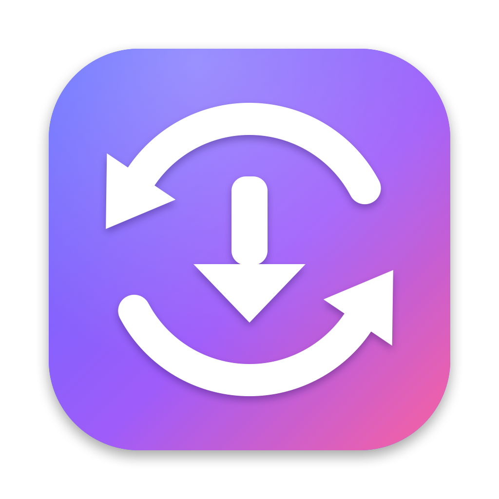

An original icon drawn in code by `Resources/AppIcon/make-icon.swift`. `./build.sh` turns it into `AppIcon.icns`.

## Screenshots

Rendered with fictional apps and the built-in snapshot harness. They show no real inventory or personal data.

| Updates (dark) | Updates (light) |
| --- | --- |
| 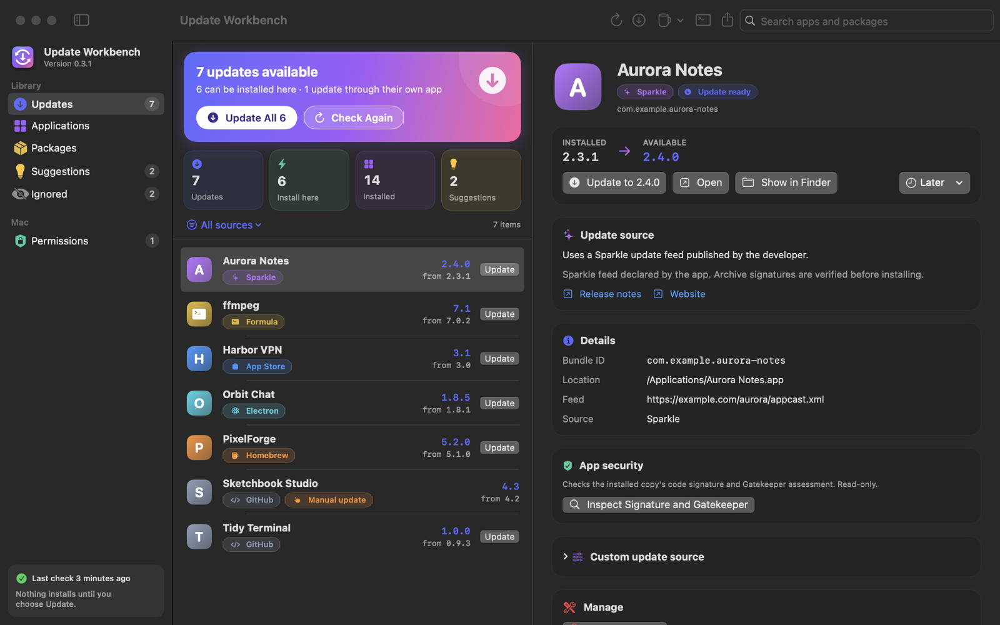 | 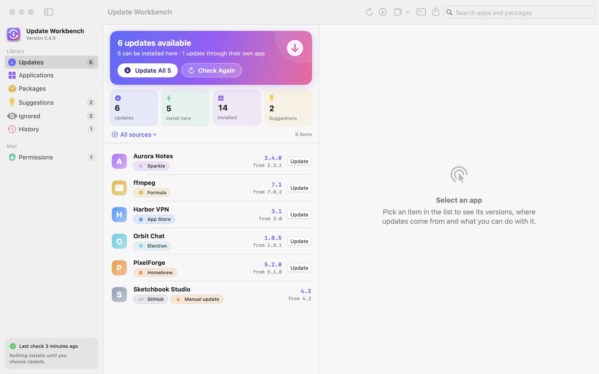 |
| **Suggestions** | **Permissions** |
| 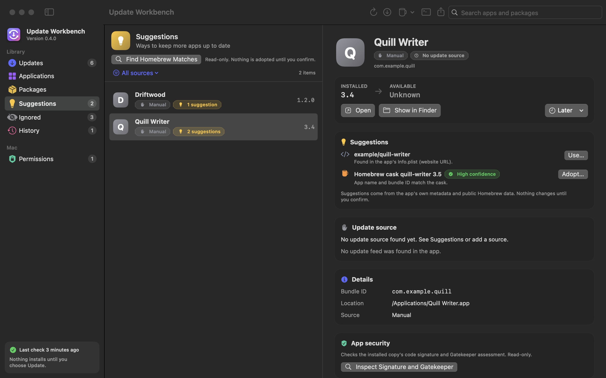 | 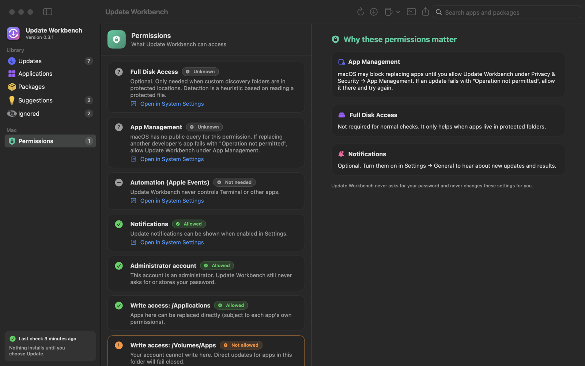 |
| **First run** | **Settings → Appearance** |
| 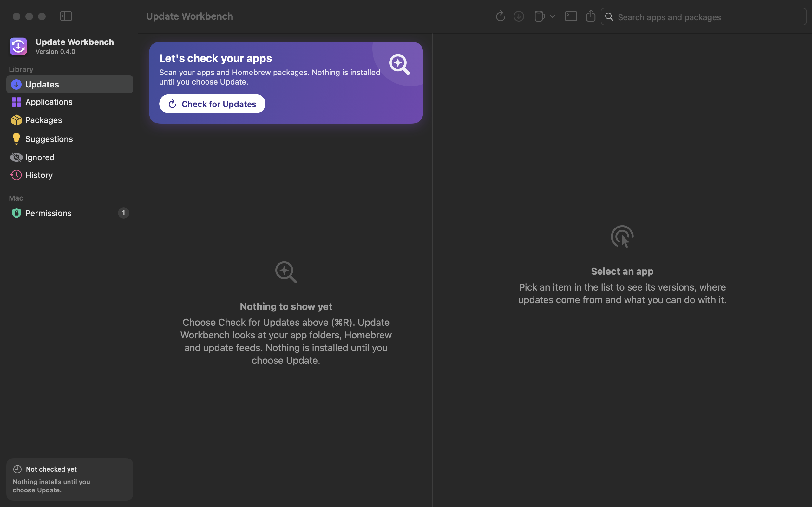 | 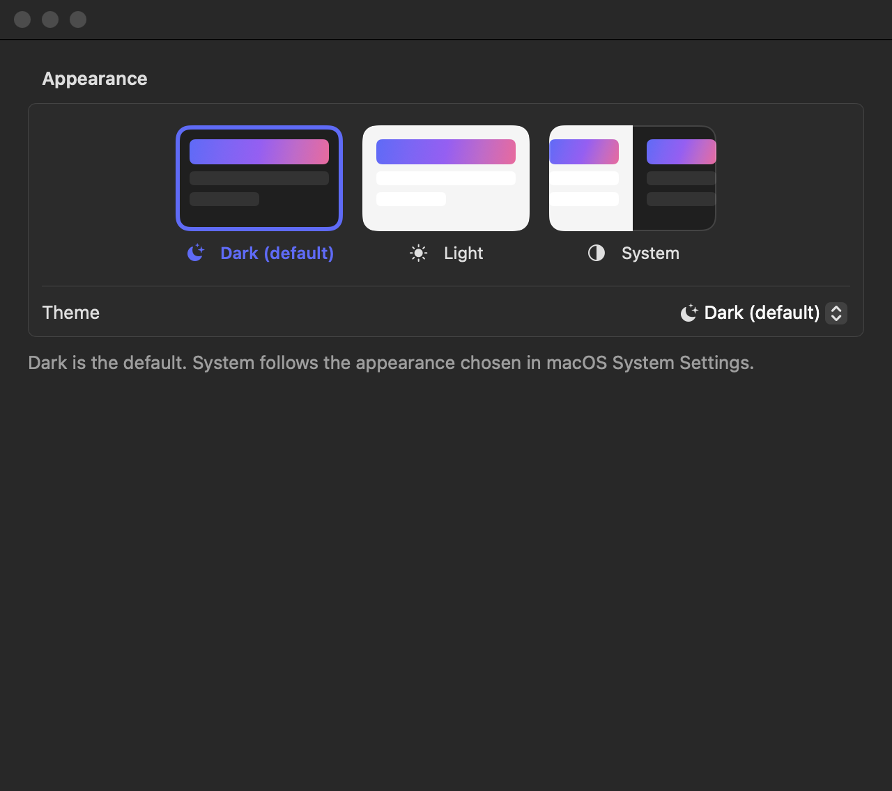 |
| **History** | **Release notes** |
| 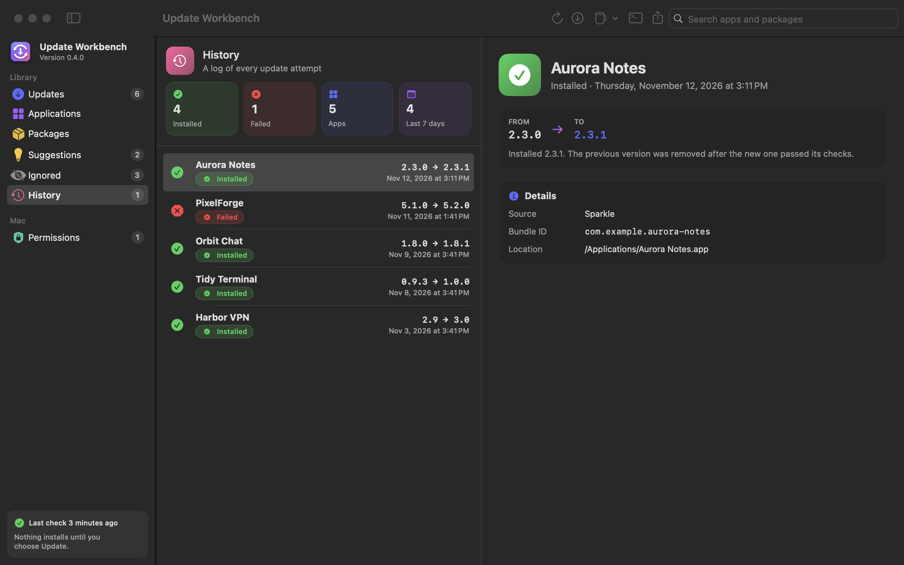 | 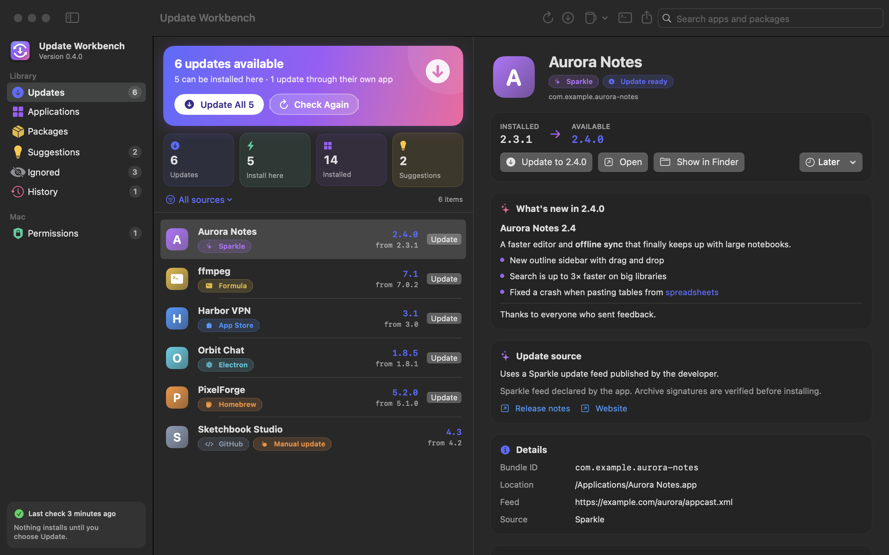 |
| **New developer signature** | **Settings → Rules** |
| 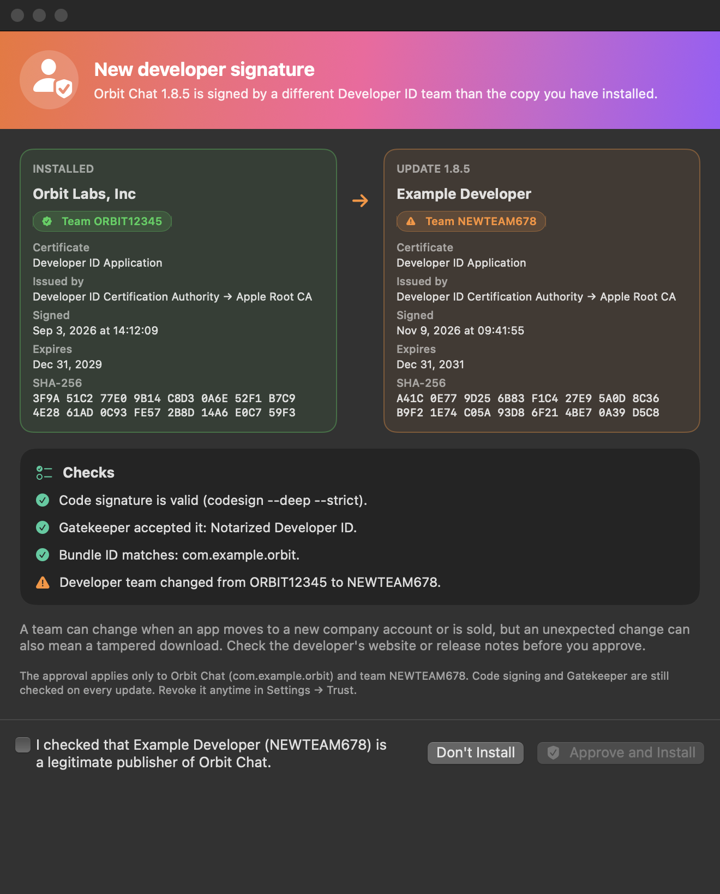 | 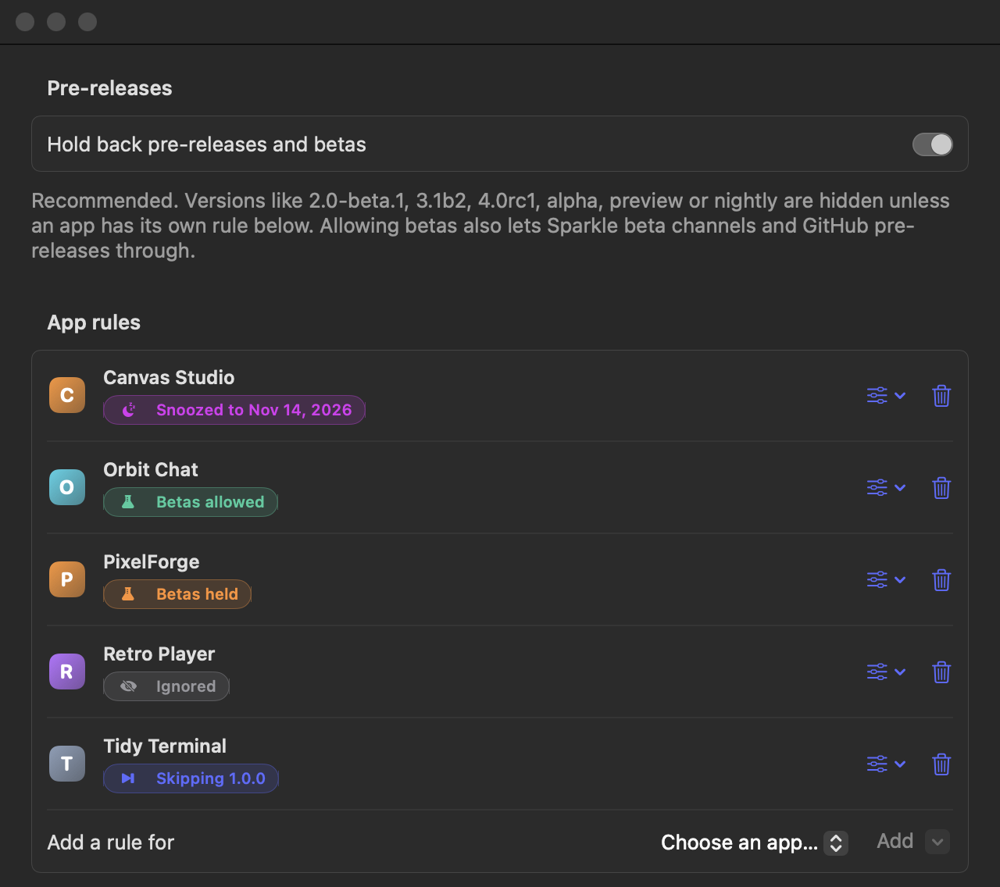 |
| **Menu bar** | **Settings → Trust** |
| 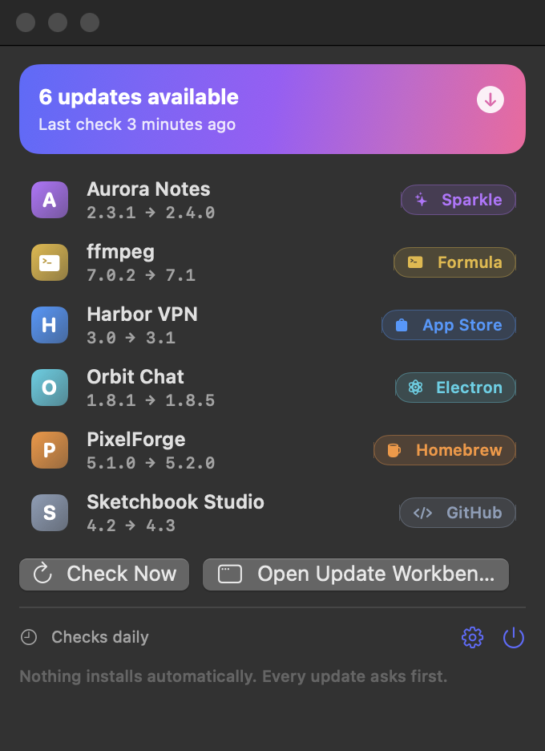 | 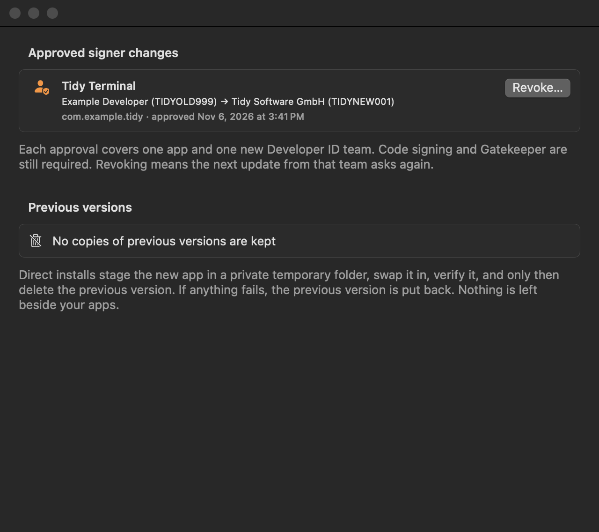 |

To render every screen yourself in dark and light (fake data, no scanning, nothing installed, real settings untouched):

```sh
./build.sh
dist.noindex/UpdateWorkbench.app/Contents/MacOS/UpdateWorkbench --render-snapshots /tmp/updateworkbench-snapshots
```

## Available features

- Inventory `/Applications`, `~/Applications`, and additional folders configured in Settings.
- Check installed Homebrew casks and formulae, optional `mas` App Store CLI, HTTPS Sparkle appcasts, Electron apps that declare an electron-updater feed, and public GitHub repositories you select.
- Direct per-item updates and sequential Update All with console results. No Terminal automation or stored passwords.
- **Electron update feeds:** apps shipping `Contents/Resources/app-update.yml` (electron-updater `github`, `generic` or `s3` provider) are checked through the published `latest-mac.yml`. One native DMG (preferred) or ZIP is chosen per CPU; its published SHA-512 must match before the normal direct-install checks run. Private/token providers, missing checksums and ambiguous payloads fail closed (update shown, direct install disabled).
- **GitHub repository suggestions:** repositories found in an app's Electron update config, Sparkle feed URL, Info.plist URLs, or its Homebrew cask homepage/URL are listed as suggestions with their evidence. Nothing is used until you choose **Use…** and confirm.
- **Homebrew cask matching and adoption suggestions:** **Find Homebrew Matches** (Suggestions section or Homebrew menu) matches apps without a package-manager route to casks using `brew casks` and `brew info --json=v2 --cask` (read-only; no `brew update`). Matches need the cask's app artifact name; a matching bundle ID raises confidence to High. Disabled casks are excluded and deprecated ones flagged. **Adopt…** shows the exact `brew install --cask --adopt` command and runs only after confirmation. App Store apps are never suggested.
- **Homebrew management:** Reinstall (Repair), Uninstall (no `--zap`, user data kept) and Unpin (pinned formulae) for Homebrew items, each behind a confirmation that shows the command.
- **Move to Trash** for non-Homebrew app bundles, after confirmation. The bundle is moved to the Trash (never deleted); running apps, symlinks, macOS system apps and Update Workbench itself are refused.
- **Vendor-managed updaters:** apps updated by Microsoft AutoUpdate, Adobe Creative Cloud (or Acrobat's own updater), Google Software Update, Mozilla's built-in updater, Squirrel.Mac (Electron) or an undeclared Sparkle feed are labelled, with a button to open the vendor's updater or the app. Vendor protocols are not driven.
- **Permissions view:** read-only status for Full Disk Access (heuristic), App Management (no public query; guidance only), Automation (not used), notifications, administrator account, write access to each application folder, launch at login and Keychain, with System Settings links.
- **Proxy settings:** system, none or manual HTTP/HTTPS or SOCKS proxy for the app's own requests. Authentication passwords are stored only in the login Keychain (Security framework, service `local.updateworkbench.proxy`) and are answered on proxy challenges. Homebrew/mas receive the proxy host and port through `http_proxy`/`https_proxy`/`all_proxy`, never the password.
- **Notifications:** optional (Settings → General) banners for newly available updates (each version announced once) and for completed or failed updates.
- **Self-update:** Settings → Updates accepts `github:owner/repository`, a GitHub repository URL, or an HTTPS Sparkle appcast. It is **disabled by default** because no release feed is published. Installation reuses the verified direct-install pipeline, so a release must match the bundle ID and Developer ID team; the ad-hoc development build cannot self-update.
- User-selected Homebrew adoption by cask token; catalog refresh; Homebrew diagnostics and cleanup.
- Rules (Settings → Rules): ignored apps, skipped versions, and pre-release holds (global, on by default, with per-app overrides); two/four-day snoozes. Pre-releases include versions such as `-beta.1`, `b2`, `rc1`, alpha, preview or nightly, Sparkle beta channels and GitHub pre-releases.
- Background checks Off, Daily or Weekly while the app runs (it stays in the menu bar), a menu bar icon with the update count and quick list, a Dock badge, launch at login, source filters, signature/Gatekeeper details, sanitized release notes, reveal/open actions, JSON inventory export.
- **Trusted signer approvals** (Settings → Trust) per bundle ID and team, stored in `~/Library/Application Support/Update Workbench/trusted-signers.json`, revocable anytime.
- **History** of every update attempt in `~/Library/Application Support/Update Workbench/history.json` (last 500). It's a log; previous versions aren't kept.
- **Mac App Store via mas:** `mas outdated --json` during checks, `mas update <id>` after confirmation, Homebrew → Install mas… when it's missing. Because mas installs with `sudo installer`, an update that needs your administrator password is handed to Terminal (**Finish in Terminal**) or the App Store app; Update Workbench never sees the password.
- Custom HTTPS feed and GitHub repository overrides keyed by bundle identifier or app path. GitHub payloads require an unambiguous native macOS ZIP/DMG; otherwise a release-page link supports manual installation. App-declared Sparkle archive signature requirements remain enforced.

Choose **Homebrew → Refresh Catalog** before checking for the newest Homebrew metadata. Routine checks and cask matching deliberately avoid implicit `brew update`. Homebrew installation is required for Homebrew operations; `mas` is optional and can be installed from the Homebrew menu. This app does not install dependencies automatically. App Store installs remain subject to Apple authentication and helper/OS compatibility. Homebrew or package installers needing an administrator password can fail; the app does not collect a password or silently elevate.

## Direct Sparkle, GitHub and Electron installs

Supports complete DMG/ZIP app payloads from public HTTPS appcasts, selected GitHub releases and declared Electron feeds. Downloads use HTTPS-only redirects and size limits. If the feed publishes a SHA-512 (Electron), it must match. If the installed app declares a Sparkle Ed25519 public key, its archive signature must verify before extraction. The app also checks bundle ID, installed signing team, code signatures, Gatekeeper approval, version, and OS/CPU compatibility. Running apps must be closed first. The new app is staged in a private folder on the same volume (never beside the app), swapped in and verified; the previous version is deleted only after that succeeds and is put back if anything fails, so no copies are left behind. The scanner skips hidden and `*-backup-*` app bundles. A different signing team stops the install and asks you to review and approve that team for the app; Gatekeeper and code signing must still pass. DMGs are checked for encryption and license agreements, attached read-only with `-nobrowse -noautoopen`, must contain exactly one app with the expected bundle ID, are copied out with `ditto`, and are always detached. When a release offers both, the DMG is preferred over the ZIP. ZIPs may contain symbolic links, such as the `Versions/Current` framework links every Electron app ships, as long as each link is relative and stays inside its `.app` bundle. The ZIP directory is checked before anything is written: absolute or escaping link targets, entries below a link, path traversal, duplicates, encrypted entries and special files are rejected, and after extraction every link must resolve inside the bundle and hard links are refused. DMGs permit only bundle-internal links. Unsigned or unapproved different-team updates, encrypted disk images, protected destinations, PKG installers, deltas and unsupported payloads fail closed. Many GitHub-distributed Electron apps are unsigned or ad-hoc signed and will therefore fail closed by design.

## Validation status

No real application upgrades, installs, adoptions, reinstalls, uninstalls, unpins or Trash moves were executed during development. Offline tests (`./test.sh`) exercise discovery, serialization, process output handling, command deadlines, custom Homebrew destinations, appcast selection, archive signature validation, GitHub release selection, security report formatting, and the 0.2.0 additions: Electron config/metadata parsing and payload selection, SHA-512 verification, GitHub repository discovery, cask JSON parsing and matching, vendor updater detection, Homebrew action arguments and token rejection, Trash-move validation with a fake Trash, permission states, notification de-duplication and text, self-update feed parsing, proxy validation/dictionaries/challenge handling, and a Keychain round trip under a throwaway test service name.

0.3.0 interface checks: every screen (Updates hero, list and detail; Applications; Packages; Suggestions; Ignored; no-results, first-run, scanning and up-to-date states; console with a failed update; Permissions; all four Settings tabs) was rendered offscreen in dark and light with fake data and reviewed. That review found and fixed a layout bug where wrapped hero text inflated the window's minimum height to about 960–1300 pt, plus truncated buttons, duplicate actions, low-contrast light-mode badges and misleading status labels. The 0.3.0 bundle launched (window opened at its 1040×680 minimum) and was quit. Confirmation dialogs, menus and hover states can't be captured offscreen and were checked in code only. Capturing the live window with `screencapture` was refused because Screen Recording isn't granted, and no system settings were changed. Prominent buttons look grey in the offscreen renders because those windows are never key; they use the accent color in the running app.

0.4.0 checks: the new screens (History, signer approval sheet, update sheet with release notes, license sheet, Settings → General, Rules and Trust, and the menu bar panel) were rendered in dark and light and reviewed. The menu bar status item itself can't be rendered offscreen; its panel can. DMG installs were tested with fixture disk images built by `hdiutil`, and the published Invoke Community Edition 1.8.5 DMG was installed end to end into a temporary copy only (see `docs/validation.md`). The final build was installed in `/Applications` on the development Mac, stayed idle at about 0% CPU, and a read-only check of 267 apps and packages listed no stale updates and no hidden or backup copies. `mas outdated --json` was run read-only; no App Store update was installed.

A read-only smoke run on the development Mac found 80 apps (2 Electron feeds, 21 vendor-managed), checked both Electron feeds live (one real newer release with a native arm64 ZIP was identified, not installed), and produced Homebrew cask suggestions for 19 apps. The 0.2.0 bundle launched and was quit; GUI navigation of the new screens was not exercised by automation. GUI launch, navigation and a read-only scan of 267 apps and packages were verified for 0.1.0; see `docs/validation.md`.

Not end-to-end validated: actual vendor downloads and installs (Sparkle, GitHub, Electron), Homebrew installation/adoption/reinstall/uninstall/unpin, App Store installation, Trash moves of real apps, notification delivery, authenticated proxies, self-update installation, login registration and rollback under real failure conditions. Permission states other than write access and admin membership are heuristics.

## Known limitations

- Squirrel.Mac Electron apps keep their update feed inside app code, so they are only labelled and opened; update.electronjs.org and vendor-specific endpoints are not probed.
- Vendor-managed updaters are opened, not driven; there is no in-app version check for Adobe, Microsoft, Google or Mozilla apps.
- Electron providers other than public `github`, `generic` and `s3` (for example private GitHub, Bitbucket, Keygen, custom), and differential (blockmap) downloads, are not supported.
- Cask matching uses app artifact names; apps whose bundle name differs from every cask artifact are not matched, and there is no automatic adoption.
- No published self-update feed or Developer ID signing and notarization yet.
- Background checks run only while Update Workbench is open (it keeps running in the menu bar); there is no separate background agent.
- Release notes are text only: images, tables and embedded media are dropped.
- `hdiutil attach` prints deprecation warnings on recent macOS versions; it still works and is used because it supports license agreements.
- Not yet available: separate app and package ignore lists and per-folder discovery settings.

Opening an unsupported app exposes its own updater. Custom feeds, suggestions and explicit Homebrew adoption cover some apps without a detected route. See `CHANGELOG.md` for changes and `docs/validation.md` for build and test records.

Primary implementation references: [Homebrew manpage](https://docs.brew.sh/Manpage), [electron-builder publish configuration](https://www.electron.build/publish), [Apple UserNotifications](https://developer.apple.com/documentation/usernotifications), [Apple Keychain Services](https://developer.apple.com/documentation/security/keychain-services), [mas CLI](https://github.com/mas-cli/mas/blob/main/README.md), [Sparkle update publishing](https://sparkle-project.org/documentation/publishing/), [GitHub Releases API](https://docs.github.com/en/rest/releases/releases).

## License

MIT, see [LICENSE](LICENSE). Copyright (c) 2026 kasakir-ai. The license covers this project's own code and assets only. Third-party app names and trademarks belong to their owners.
